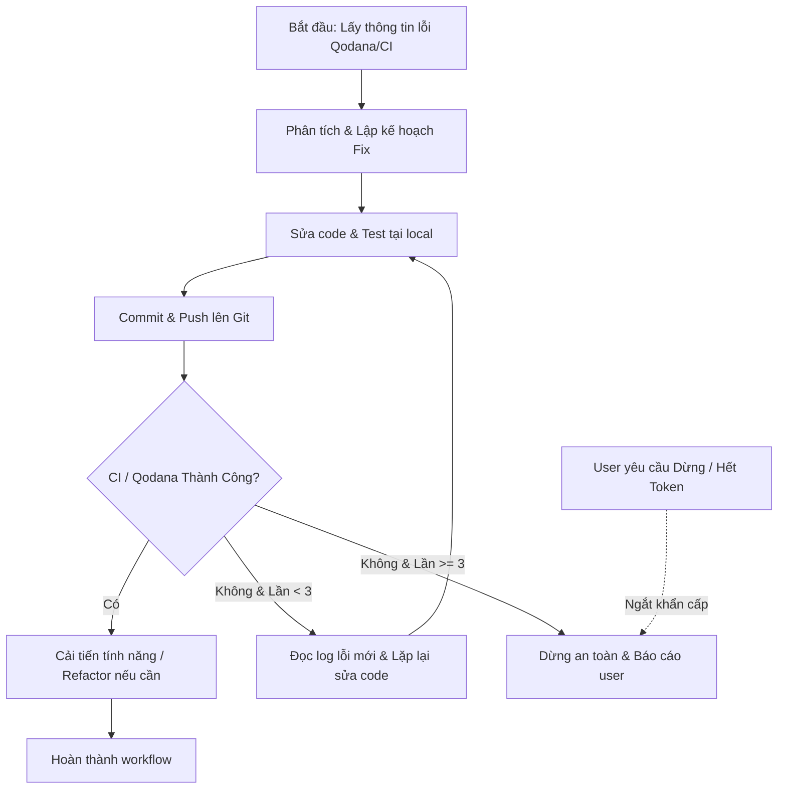

# /auto-heal - Tự Động Sửa Lỗi, Đẩy Code & Vòng Lặp Self-Healing

## Mục đích
Quy trình tự động hóa khép kín:
1. Phát hiện lỗi tự động từ Qodana, GitHub Actions CI hoặc local check.
2. Tự động sửa code theo thứ tự ưu tiên (Critical → High → Smell).
3. Đẩy code lên Git và theo dõi kết quả.
4. **Vòng lặp tự phục hồi (Self-Healing)**: Nếu CI báo lỗi mới, tự động đọc log, phân tích và sửa tiếp.
5. Cải thiện tính năng / hiệu năng nếu code đã sạch lỗi.
6. **Cơ chế dừng an toàn (Safety Stop & Token Guard)**: Dừng ngay khi user yêu cầu hoặc khi đạt ngưỡng giới hạn lặp/token.

---

## 🛑 NGUYÊN TẮC AN TOÀN & BẢO VỆ TOKEN (BẮT BUỘC)

> [!IMPORTANT]
> **Điều kiện dừng ngay lập tức (Immediate Abort)**:
> 1. **User Stop**: Nếu người dùng gửi bất kỳ từ khóa nào như `dừng`, `stop`, `pause`, `hủy`, `cancel`, `thôi` → **Dừng lại ngay lập tức**, báo cáo trạng thái hiện tại và KHÔNG gọi thêm tool nào.
> 2. **Token / Step Budget**: 
>    - Giới hạn tối đa **3 vòng lặp (Max 3 Iterations)** cho việc sửa lỗi lặp lại.
>    - Nếu sau 3 lần sửa mà CI vẫn lỗi: **Dừng lại**, tổng hợp log lỗi và hỏi ý kiến user thay vì tiếp tục đốt token.
> 3. **Non-destructive**: Tuyệt đối không xóa migrations Flyway, không sửa credentials, không `git push --force` vào nhánh chính (`main`).

---

## Các Giai Đoạn (Phases)



---

### Phase 1: Thu Thập & Phát Hiện Lỗi Tự Động
1. **Kiểm tra trạng thái Git local**:
   ```bash
   git status --short
   ```
2. **Kéo kết quả Qodana / CI từ GitHub**:
   - Gọi GitHub API để lấy thông tin check runs và comments mới nhất của PR / commit:
     ```bash
     powershell -Command "Invoke-RestMethod -Uri 'https://api.github.com/repos/pnam-it309/AeroStride/actions/runs?per_page=5' -Headers @{'User-Agent'='Antigravity'}"
     ```
   - Tải artifact `qodana-report` (nếu có) hoặc đọc PR review annotations để trích xuất file và dòng lỗi cụ thể.
3. **Phân loại mức độ lỗi**:
   - 🔴 **P0 - Critical / Failure**: Vulnerable dependencies, Invalid configuration, Syntax / Compilation errors, Security CVEs.
   - 🔶 **P1 - Warning**: Nullability, Regex duplicates, Resource leaks, Deprecated API, Unused imports.
   - ◽️ **P2 - Notice / Code Smell**: Stream simplifications, Redundant conditions, Duplicate code.

---

### Phase 2: Sửa Code Tại Local (Auto-Remediation)
1. **Áp dụng nguyên tắc Minimal Diff**:
   - Chỉ chỉnh sửa đúng vị trí lỗi, giữ nguyên logic nghiệp vụ hiện có.
   - Không tự ý format lại toàn bộ file nếu không cần thiết.
2. **Thứ tự thực hiện**:
   - Sửa cấu hình sai (`application.properties`, `package.json`, `build.gradle`).
   - Xóa bỏ import thừa, regex lỗi, biến thừa.
   - Sửa lỗi logic nghiệp vụ và type safety.
3. **Kiểm tra sơ bộ**:
   - Đảm bảo syntax không bị vỡ sau khi sửa.

---

### Phase 3: Đẩy Code Lên Git
1. **Tạo commit theo Conventional Commits**:
   - Định dạng: `fix(scope): mô tả ngắn gọn lỗi đã sửa theo Qodana`
   - Ví dụ: `fix(core): resolve regex duplicate character and unused imports`
2. **Push code lên branch**:
   ```bash
   git push origin [tên-branch]
   ```
3. **Thông báo cho user** bước push đã hoàn thành và hệ thống đang chờ kết quả CI scan.

---

### Phase 4: Vòng Lặp Tự Phục Hồi (Self-Healing Loop)
1. **Kiểm tra phản hồi user**:
   - Nếu user ra lệnh dừng → **NGỪNG TOÀN BỘ**.
2. **Đợi kết quả CI GitHub Actions**:
   - Kiểm tra trạng thái workflow sau khi push.
3. **Nếu CI Pass**:
   - Chuyển sang Phase 5 (Cải tiến tính năng).
4. **Nếu CI Fail / Qodana vẫn còn lỗi**:
   - Tăng biến đếm `iteration_count += 1`.
   - **Kiểm tra điều kiện dừng**: Nếu `iteration_count > 3` → Dừng lại, in ra bảng lỗi còn tồn đọng và xin ý kiến user.
   - Nếu `iteration_count <= 3`: Tự động đọc log lỗi từ bước fail, xác định nguyên nhân và quay lại **Phase 2**.

---

### Phase 5: Cải Thiện Tính Năng (Feature Improvement)
*Chỉ thực hiện khi tất cả lỗi Critical và Warning đã được giải quyết:*
1. **Tối ưu hiệu năng**:
   - Rút gọn các biểu thức Stream API phức tạp.
   - Tối ưu query JPA hoặc caching (Redis/Cache).
2. **Tăng cường bảo mật**:
   - Thêm validation cho các DTO/Request còn thiếu.
   - Cập nhật headers an toàn hoặc rate limiting.
3. **Review với user**:
   - Trình bày tóm tắt các điểm cải tiến trước khi commit.

---

### Phase 6: Báo Cáo & Kết Thúc
1. Tổng hợp danh sách lỗi ban đầu vs lỗi đã sửa thành công.
2. Liệt kê các commit đã push.
3. Thông báo link PR / kết quả GitHub Actions mới nhất cho người dùng.
